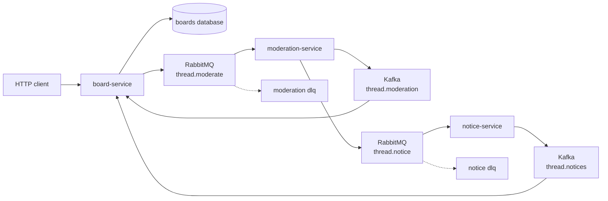
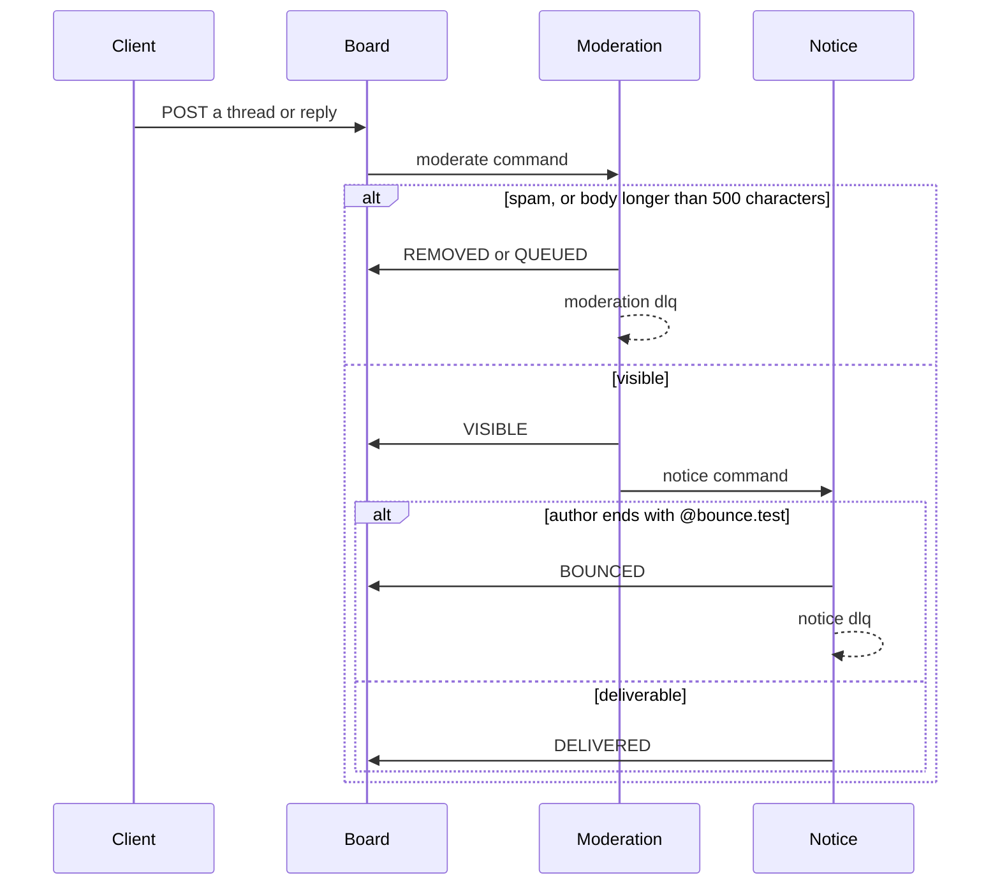

# Thread Hall

A board stores a thread, moderation decides whether it is visible, and a notice goes to the author. A body that contains `spam` is removed. A body longer than 500 characters waits. An author whose name ends in `@bounce.test` can still be visible, and the notice lands on a dead-letter queue.

Replies use the same two hops. A visible reply increments the thread once. The three services do not call each other.





## Why three services

Moderation is the only place that reads the body. The notice service never sees a removed post, because the notice command is sent only after a visible decision. The reply count is a single increment guarded by the reply id, so overlapping visible replies add instead of overwriting.

A removed or queued post is rejected onto `thread.moderate.dlq` after the decision is published. A bounced notice is rejected onto `thread.notice.dlq` and stores no delivered row. There is no outbox. The moderate command is sent after the post row commits.

## Run

JDK 17, Maven 3.9, and Docker.

```bash
mvn -q -DskipTests package
docker compose up --build -d
./scripts/smoke.sh
```

| Process | URL |
| --- | --- |
| board-service | http://localhost:8141 |
| moderation-service | http://localhost:8142 |
| notice-service | http://localhost:8143 |
| RabbitMQ management | http://localhost:15679 |
| Postgres | localhost:5439 |
| Kafka (host listener) | localhost:9100 |

```bash
docker compose down
```

## Calls

```bash
curl -s -X POST localhost:8141/boards \
  -H 'content-type: application/json' \
  -d '{"name":"General"}'

curl -s -X POST localhost:8141/boards/$BOARD/threads \
  -H 'content-type: application/json' \
  -d '{"authorName":"Ada","title":"Hello","body":"A short post."}'

curl -s localhost:8141/threads/$THREAD
curl -s localhost:8143/notices/$THREAD
```

500 characters is visible. 501 is queued. A removed post has no notice.

## Where the same split goes on Google Cloud

This repository runs on Compose. Nothing in it calls a cloud account, and there is no Pub/Sub client in the process.

| Compose | Google Cloud |
| --- | --- |
| Postgres 16 | Cloud SQL for PostgreSQL |
| Kafka 3.8 | a Pub/Sub topic for the decision log, or a managed Kafka |
| RabbitMQ 3.13 | a Pub/Sub subscription with a dead-letter topic |
| the three services | Cloud Run or GKE |

## Local credentials

The Compose network is open. Do not publish these ports.

| | |
| --- | --- |
| Postgres | `platform` / `platform` |
| RabbitMQ | `platform` / `platform`, vhost `/` |
| HTTP | no authentication |

## Tests

`mvn test` checks the spam, length, and bounce rules with no Docker. `./scripts/smoke.sh` shows a normal post, removes spam, queues 501 characters, shows 500 characters, bounces an author, counts twenty overlapping replies, and ignores a spam reply in that count.

## Same shape, different domain

- [Live Lobby](https://github.com/joshbarros/java-live-lobby)
- [Loyalty Ledger](https://github.com/joshbarros/java-loyalty-ledger)
- [Claims Desk](https://github.com/joshbarros/java-claims-desk)
- [Checkout Counter](https://github.com/joshbarros/java-checkout-counter)
- [Study Hall](https://github.com/joshbarros/java-study-hall)
- [Clearing Desk](https://github.com/joshbarros/java-clearing-desk)
- [Yard Gate](https://github.com/joshbarros/java-yard-gate)
